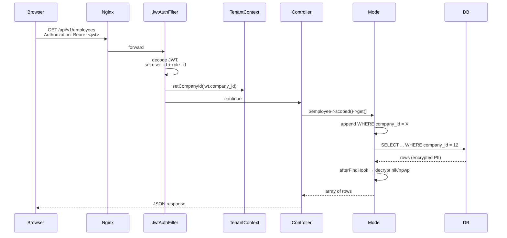
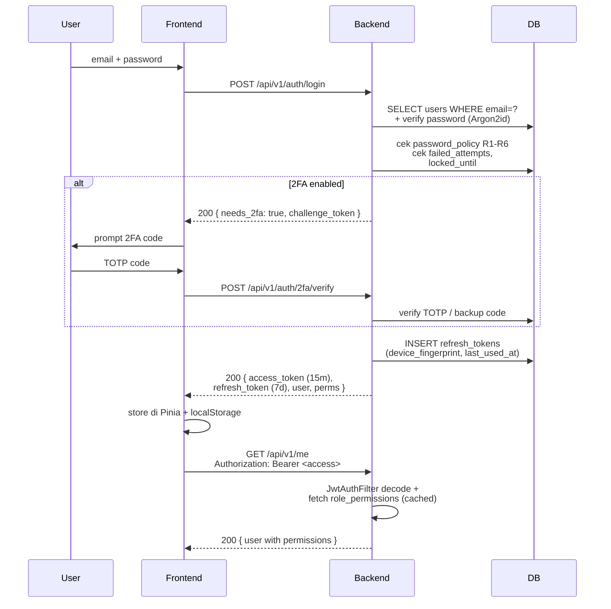
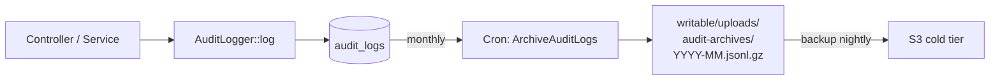
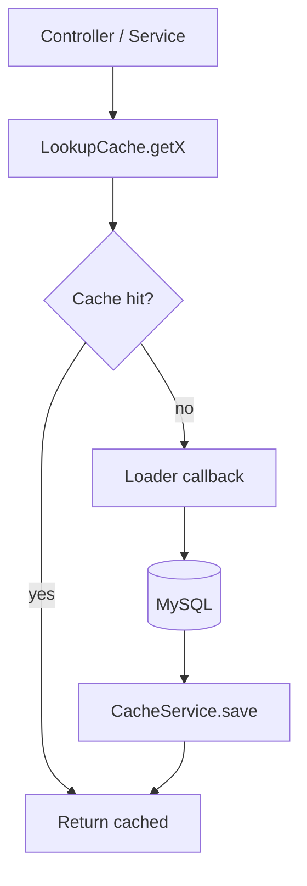

# HRIS — System Architecture

> Sprint G / I5. High-level diagram + reasoning di balik keputusan arsitektur.
> **Audience:** developer baru + reviewer external.
> **Reference utama:** `docs/decisions/0001-architecture-baseline.md` (ADR).

---

## 1. Stack Overview

```
┌─────────────────────────────────────────────────────────────────────┐
│  Browser / PWA (Mobile-first)                                       │
│  - Vue 3.5 + Composition API + <script setup>                       │
│  - Pinia 2 (state), Vue Router 4, Axios 1.7                         │
│  - Tailwind CSS 3 + dark mode (composables/useDarkMode.js)          │
│  - Service worker (composables/usePwa.js)                           │
└────────────────────────────────┬────────────────────────────────────┘
                                 │ HTTPS, JSON, JWT Bearer
                                 ▼
┌─────────────────────────────────────────────────────────────────────┐
│  Nginx (TLS terminator + static + reverse proxy)                    │
│  - Static SPA: dist/ dari frontend Docker image                     │
│  - /api/v1/* → fastcgi → backend php-fpm:9000                       │
│  - /uploads/* → static dari volume backend_writable                 │
└────────────────────────────────┬────────────────────────────────────┘
                                 │ FastCGI (internal network only)
                                 ▼
┌─────────────────────────────────────────────────────────────────────┐
│  Backend (CodeIgniter 4 / PHP 8.2)                                  │
│  ┌───────────────┐   ┌──────────────┐   ┌──────────────────────┐    │
│  │  Filters      │ → │ Controllers  │ → │ Services / Libraries │    │
│  │  - JwtAuth    │   │ Api/V1/*     │   │ - PayrollService     │    │
│  │  - Permission │   │ ≤500 baris   │   │ - LeaveBalanceSvc    │    │
│  │  - SameOrigin │   │ (target)     │   │ - LookupCache        │    │
│  │  - Throttle   │   │              │   │ - CircuitBreaker     │    │
│  │  - CORS       │   │              │   │ - AuditLogger        │    │
│  └───────────────┘   └──────────────┘   └──────────┬───────────┘    │
│                                                    │                │
│                                          ┌─────────▼──────────┐     │
│                                          │ Models (BaseModel) │     │
│                                          │ Multi-tenant scope │     │
│                                          │ Encrypt/decrypt    │     │
│                                          └─────────┬──────────┘     │
└────────────────────────────────────────────────────┼────────────────┘
                                                     │
            ┌────────────────────┬───────────────────┼────────────────┐
            ▼                    ▼                   ▼                ▼
┌─────────────────┐  ┌────────────────┐  ┌──────────────────┐  ┌─────────────┐
│ MySQL 8         │  │ Redis 7        │  │ Cron worker      │  │ External    │
│ - Multi-tenant  │  │ - Cache layer  │  │ - 20+ spark cmds │  │ services    │
│ - Encrypted PII │  │ - Session      │  │ - Daily/weekly/  │  │ (WhatsApp,  │
│ - Audit logs    │  │ - Rate limit   │  │   monthly tasks  │  │  OCR, AI)   │
│   hash chain    │  │ - Circuit      │  │                  │  │ behind      │
│                 │  │   breaker state│  │                  │  │ CircuitBkr  │
└─────────────────┘  └────────────────┘  └──────────────────┘  └─────────────┘
```

Layanan eksternal di-isolate dengan `CircuitBreaker` (Sprint D6) supaya provider lambat tidak menggantungkan request HRIS — fail-fast setelah threshold.

---

## 2. Multi-Tenancy

Setiap tabel domain (employees, leaves, payslips, dst.) punya kolom `company_id`. **Semua query wajib di-scope** lewat:

1. **`BaseModel::scoped()`** — auto-apply `WHERE company_id = X` dari `TenantContext` (Service `tenant`).
2. **`PrivacyScope`** — filter row-level untuk employee-level isolation (employee A tidak bisa lihat data employee B di tenant yang sama, kecuali punya permission `employee.view_all`).

**Super admin escape hatch:** user dengan `role_id = 1` atau `company_id = 0` boleh override `X-Company-Id` header. Tindakan ini di-audit log dengan event `super_admin.tenant_switch` (lihat `JwtAuthFilter`).



---

## 3. Data Flow — Authentication



Token rotation:

- Access token TTL 15 menit (configurable).
- Refresh token TTL 7 hari, terikat `device_fingerprint`. Logout = revoke 1 device.
- "Sign out all" = revoke semua refresh token user (`/api/v1/auth/sessions/all`).

---

## 4. Permission Model

```
companies ─┬── (NULL untuk system role)
           │
           ▼
roles ─────── role_permissions ───── permissions
   │                                       │
   │                                       │ slug = "employee.create",
   │                                       │ "leave.approve_subordinate", dst
   ▼
users ──────── refresh_tokens
   │              (device_fingerprint)
   ▼
employees ─── multi-tenant scoped
```

Cek permission terjadi di 2 tempat:

1. **`PermissionFilter`** di `Routes.php` (target: semua route write, masih carry-over Sprint B+1).
2. **`tenant()->hasPermission(slug)`** di controller (legacy pattern, akan migrate ke filter).

Daftar slug + role default ada di seeder `app/Database/Seeds/InitialSeeder.php` dan `app/Database/Migrations/2024-01-01-000047_SeedEnterpriseRoles.php`.

---

## 5. Encryption Strategy

Field PII di-encrypt at-rest dengan AES-256-GCM (lihat `app/Libraries/Encryption.php`):

| Tabel        | Field plaintext | Field cipher        | Hash lookup    |
|--------------|-----------------|---------------------|----------------|
| `employees`  | `nik`           | `nik_encrypted`     | `nik_hash`     |
| `employees`  | `npwp`          | `npwp_encrypted`    | —              |
| `employees`  | `bank_account`  | `bank_account_encrypted` | —         |
| `employee_families` | `nik`    | `nik_encrypted`     | —              |
| `candidates` | (similar)       | (similar)           | —              |

`nik_hash` (sha256) memungkinkan lookup tanpa decrypt seluruh tabel:

```php
// EmployeeModel::findByNik($nik)
$hash = hash('sha256', trim($nik));
return $this->scoped()->where('nik_hash', $hash)->first();
```

**Key rotation:** `RotateEncryption` command (lihat `app/Commands/RotateEncryption.php`) mendukung multi-key — tag versi key di prefix ciphertext. SOP rotasi belum di-document (carry-over B8).

---

## 6. Audit Trail

Setiap mutation di-log ke tabel `audit_logs` lewat `AuditLogger`:

- Hash chain: `entry_hash = sha256(previous_hash || row_canonical_json)`. Tampering ke-detect dengan `php spark audit:verify-chain`.
- Index `(company_id, table_name, record_id, created_at)` untuk lookup history per record.
- Archival otomatis ke `writable/uploads/audit-archives/` setelah > 1 tahun (compliance UU PDP 7 tahun retention via cold storage).



---

## 7. Caching Strategy

Layer cache dipakai untuk lookup data quasi-static. Lihat `LookupCache` library:



Resource di-cache + TTL:

- UMP/UMK rates: 1 hari
- Holidays per company: 1 jam
- Role permissions: 1 jam
- BPJS rates: 1 hari
- TER rates PMK 168: 1 minggu
- Payroll settings: 15 menit

Invalidation eksplisit lewat `forget*()` saat admin update master.

---

## 8. Frontend Architecture (Vue 3)

```
src/
├── App.vue                   # Root router-view + global modal
├── main.js                   # bootstrap pinia + router + i18n
├── api/                      # axios client + interceptor
├── assets/                   # icons, images, styles
├── components/               # shared (SimpleMaster, ExcelImporter, ...)
├── composables/              # useDarkMode, useConfirm, usePwa, useResource
├── layouts/                  # AppLayout (auth-required), AuthLayout
├── locales/                  # i18n: en.js, id.js
├── router/                   # route definitions, lazy-loaded
├── stores/                   # pinia: auth, ui, tenant
└── views/                    # halaman per modul (Master/, Employees/, ...)
```

State lifecycle:

- **`stores/auth.js`** — JWT, user, permissions, refresh logic.
- **`stores/tenant.js`** — company aktif (super admin yang bisa switch).
- **`stores/ui.js`** — toast queue, sidebar collapsed, dark mode (delegate ke `useDarkMode`).

Fetching pattern (carry-over Sprint E Phase 2): konsolidasi ke `useResource(name)` composable supaya tiap view tidak custom axios call.

---

## 9. Cron Jobs

20+ spark commands dijadwalkan via `deploy/cron.txt` (lihat `docs/CRON_JOBS.md` untuk detail jadwal). Group:

| Group        | Commands                                                   |
|--------------|-----------------------------------------------------------|
| Compliance   | CheckBpjsCompliance, CheckProbationDeadline, CheckCertExpiry |
| Lifecycle    | DeactivateResigned, ApplyJic, ApplyTransfers              |
| Leave        | RunLeaveAnniversaryCarry, RunLeaveYearEnd, NotifyCarryOverCap |
| Notification | ProcessEmailQueue, CheckMppOverdue, CheckOfferExpiry, CheckHelpdeskSla |
| Maintenance  | ArchiveAuditLogs, CleanupAttachments, WarmCache, RotateEncryption |
| Webhook      | ProcessWebhooks                                            |

Cron di-isolate ke container `cron` terpisah (anti race condition + restart isolation).

---

## 10. Test Pyramid (Saat Ini vs Target)

```
                     E2E (Playwright)
                     0 / target 30
                    ────────────────
                  Feature/Integration
                  1 / target 100
                ───────────────────────
              Unit (PHPUnit + Vitest)
              847 backend + 25 frontend
            ─────────────────────────────
            Static analysis (PHPStan + ESLint)
            Level 0 / target level 6
```

Total saat ini: **872 test**. Sprint B+1/D+1 + Sprint E Phase 1 sudah menambah +85 test dari baseline awal 754.

---

## 11. Dependency Footprint

**Backend:**

- `codeigniter4/framework` 4.5+ (LTS)
- `firebase/php-jwt` 6.x
- `phpoffice/phpspreadsheet` (xlsx import)
- `dompdf/dompdf` (PDF render)
- `fakerphp/faker` (test fixtures, test only)

**Frontend:**

- Vue 3.5, Vue Router 4, Pinia 2
- Vite 5, Vitest 2
- Tailwind 3
- @heroicons/vue, @vueuse/core
- chart.js + vue-chartjs
- vue-toastification (transitional — RC version, planned migrate ke alternative kalau RC tidak naik stable Q4-2026)

Audit dependency lewat `composer audit` + `npm audit` di CI tiap PR. Dependabot configured (`.github/dependabot.yml`) — review SLA < 7 hari.

---

## 12. Decision Records (ADR)

| Nomor | Judul                              | Status   | File                                              |
|-------|------------------------------------|----------|---------------------------------------------------|
| 0001  | Architecture Baseline (Models, controller size, service split) | Accepted | `docs/decisions/0001-architecture-baseline.md`   |

ADR baru dibuat untuk setiap keputusan arsitektur signifikan (queue choice, secret manager, dst.).

---

## 13. Glossary

- **Tenant** = Company. 1 deployment HRIS bisa serve banyak perusahaan (multi-tenant via `company_id`).
- **PII** = Personally Identifiable Information (NIK, NPWP, bank account). Diatur UU PDP 27/2022.
- **PKWT/PKWTT** = jenis kontrak kerja Indonesia (Pasal 56 UU 13/2003 + UU Cipta Kerja).
- **TER** = Tarif Efektif Rata-rata, metode hitung PPh 21 baru per PMK 168/2023.
- **JIC** = Job Information Change (promosi/demosi/mutasi).
- **MPP** = Manpower Planning (request kebutuhan SDM dari line manager ke HR).
- **PHK** = Pemutusan Hubungan Kerja.
- **PWD** = (kalau muncul di doc lama) Personal Workspace Drawer — sudah di-rename ke "Inbox" di UI.